# forja

**forja** es una skill de Claude Code que convierte un tema, o un repositorio de GitHub, en una **guía visual interactiva para aprenderlo**: un solo archivo HTML que funciona sin internet, investigado en fuentes oficiales, con animaciones, preguntas para predecir antes de ver, simuladores y tarjetas de repaso espaciado.

```text
/forja el ensayo, nivel secundaria
/forja derivadas
/forja https://github.com/earthtojake/text-to-cad
```

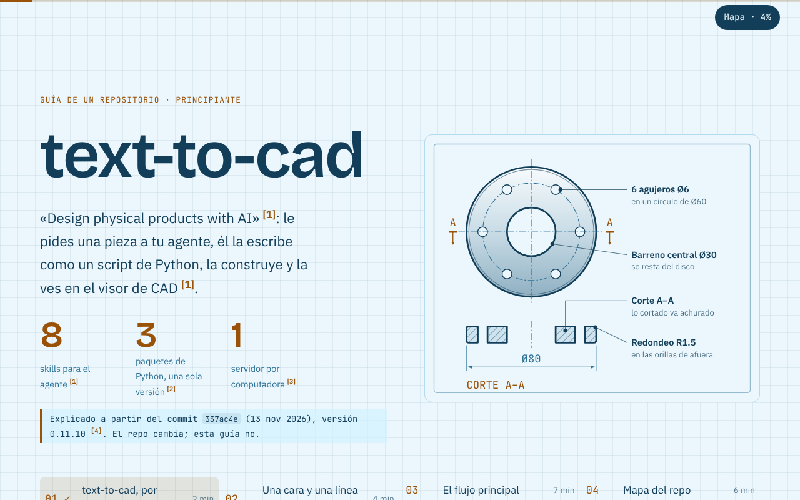

## Por qué existe

Leer una explicación larga no es la mejor forma de aprender, sobre todo si aprendes viendo. forja aplica lo que funciona según la ciencia del aprendizaje:

- **Predecir antes de ver.** Cada sección clave empieza con una pregunta. Adivinas, aunque te equivoques, y la respuesta aparece con el porqué.
- **Ver el proceso, no leerlo.** Lo que se mueve se anima, con la física o la lógica reales y con control paso a paso.
- **Ejemplos resueltos que se desvanecen.** Los primeros pasos vienen hechos; después los completas tú.
- **Repaso espaciado.** Las tarjetas vuelven a los 1, 3, 7, 16 y 35 días.
- **Bloques cortos y avance guardado.** Sales y vuelves donde ibas.

## Las guías de este repo

| Guía | Para | Nivel | Familia visual | Qué se anima |
|---|---|---|---|---|
| [El ensayo](guias/el-ensayo/) | Examen de Español de secundaria | principiante | lengua-y-literatura | Un ensayo que se escribe y se marca párrafo a párrafo |
| [Derivadas](guias/derivadas/) | Cálculo universitario | principiante | matematicas | La secante que se vuelve tangente cuando h → 0 |
| [Motores de combustión externa](guias/motor-de-combustion-externa/) | Termodinámica | principiante | maquinas-termicas | Un Stirling de dos pistones y el ciclo de vapor |
| [Git](guias/git/) | Control de versiones | principiante | control-de-versiones | `git add` y `git commit` entre las tres zonas |
| [Git: merge vs rebase](guias/git-merge-rebase/) | Control de versiones | intermedio | control-de-versiones | Merge (dos padres) contra rebase (copias con otro hash) |
| [Hooks de Claude Code](guias/hooks-de-claude-code/) | Claude Code | principiante | claude-code | El ciclo de una sesión con sus eventos |
| [Subagentes de Claude Code](guias/subagentes-de-claude-code/) | Claude Code | principiante | claude-code | Cómo se delega una tarea |
| [text-to-cad, por dentro](guias/text-to-cad/) | Un repositorio de GitHub | principiante | diseno-cad | Un pedido que viaja por los 8 archivos reales hasta el visor |

Para verlas, abre `index.html` o cualquier `guias/<guía>/index.html` en el navegador. Si activas GitHub Pages (Settings → Pages → rama `main`, carpeta raíz), cada guía queda en `https://<usuario>.github.io/forja-skill/guias/<guía>/`.

## Cómo se ve

**Predecir antes de ver.** El dibujo está borroso hasta que contestas. Luego sabes si acertaste y por qué:

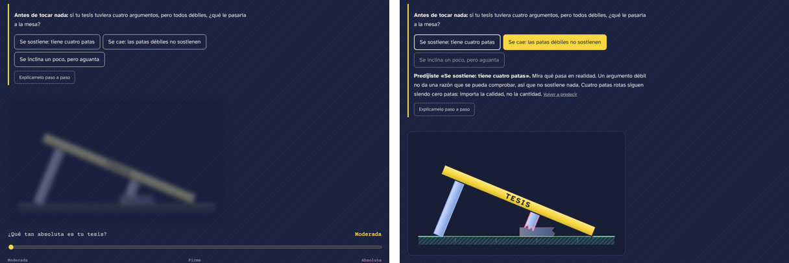

**Animaciones con la física real.** Todo se calcula desde la fase del ciclo: los pistones a 90°, el calor que entra y sale en el momento justo. En la guía tienen Pausa, Paso a paso y velocidad; aquí, un ciclo completo:

| Motor Stirling | Derivadas | Flujo de un repo |
|---|---|---|
| 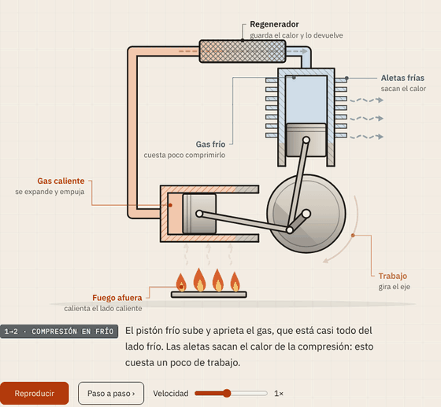 | 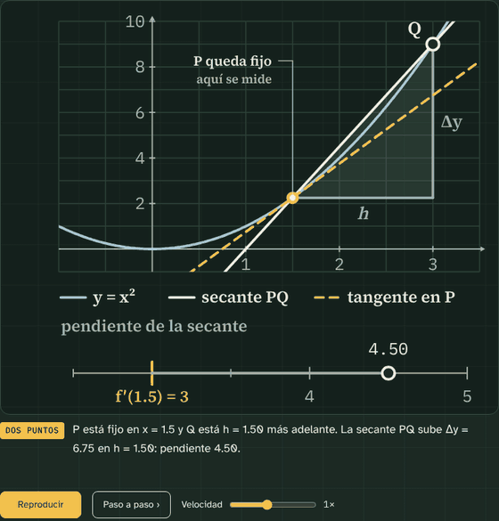 | 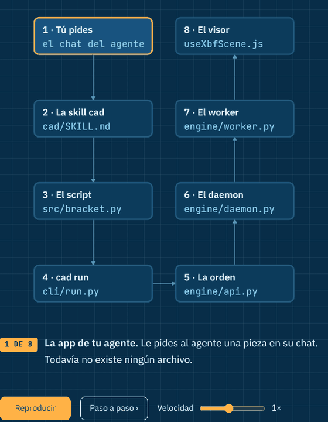 |

**Cada familia de temas tiene su propio estilo.** Los temas relacionados se parecen sin ser iguales. Los colores salen del propio tema y significan algo (en el ensayo, amarillo = tesis y azul = argumentos):

| El ensayo | Motor | Git |
|---|---|---|
| 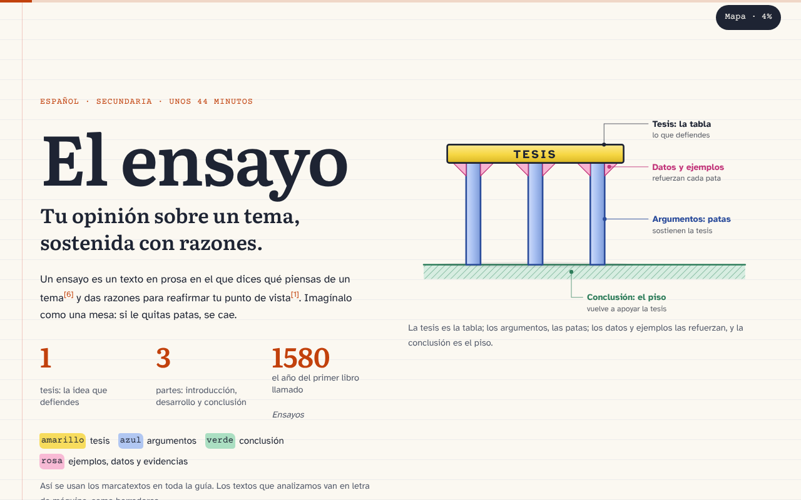 | 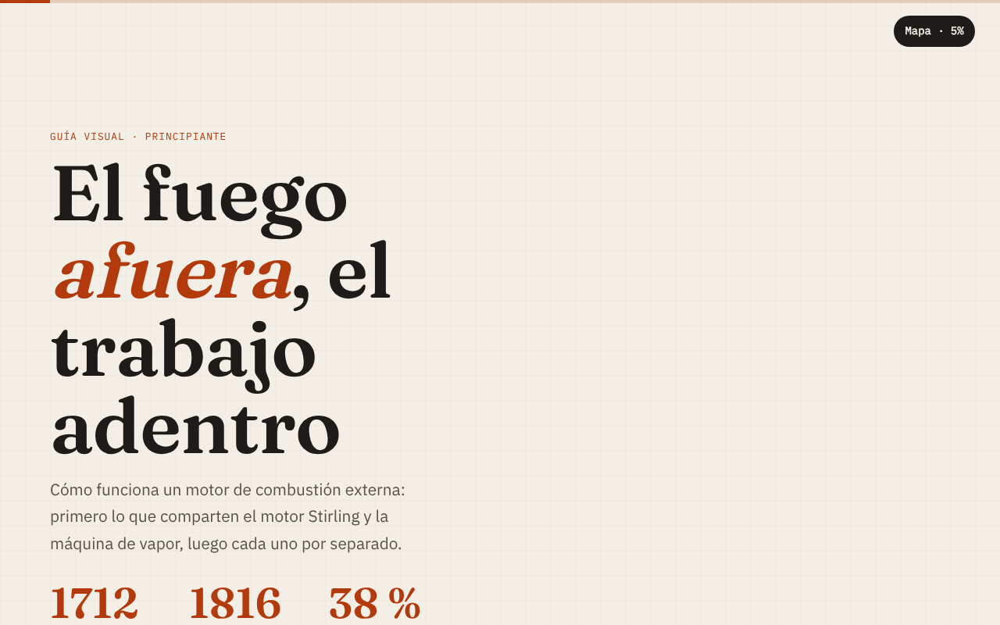 | 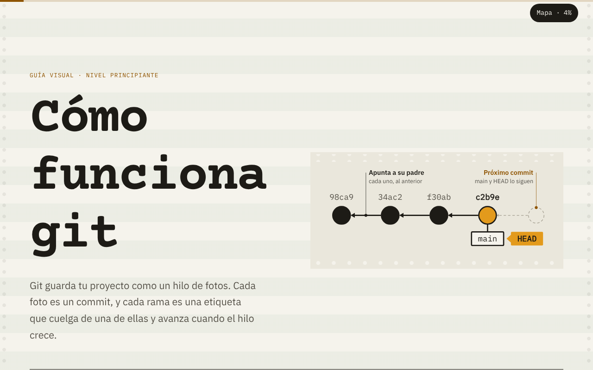 |

**Instrucciones automáticas y celular.** Cada guía cuenta lo que trae y explica cómo usarlo. En el celular, las etiquetas de los dibujos se vuelven números con una leyenda:

| Cómo usar esta guía | En el celular |
|---|---|
| 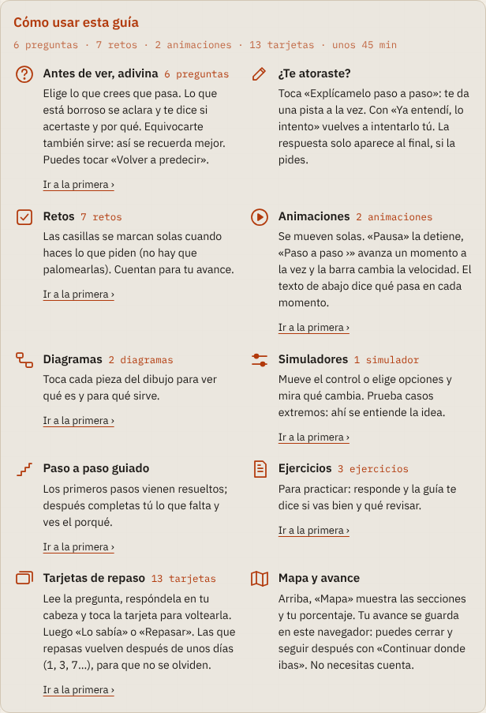 | 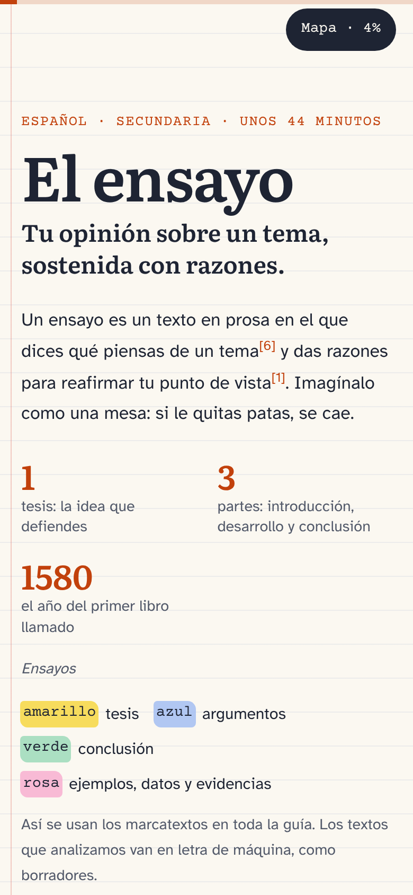 |

## Qué trae cada guía

- **Preguntas para predecir** (5 a 9 por guía), cada una con «Explícamelo paso a paso»: una pista a la vez y la respuesta solo al final.
- **Retos** que se marcan solos cuando haces la tarea.
- **Animaciones** del proceso central, con controles.
- **Diagramas clicables, simuladores y pasos guiados** que se desvanecen.
- **8 a 15 tarjetas** con repaso espaciado (método Leitner). El índice junta el «repaso de hoy» de todas las guías.
- **Citas** junto a cada dato, con la lista de fuentes oficiales. Lo que no se encontró en una fuente oficial se marca con †.
- **Un solo archivo de 240 a 290 KB, sin internet:** las fuentes tipográficas (licencia OFL) van incrustadas.

## Guías de un repositorio

Con una URL de GitHub, forja cambia de modo ([reference/repos.md](.claude/skills/forja/reference/repos.md)):

- **La fuente es el código.** Cada dato lleva un link al archivo y las líneas, fijado a un commit. La guía de text-to-cad tiene **108 citas**, y `citas_repo.py` comprobó que todas existen en el commit `337ac4e`.
- **Ejemplos reales** del repo, de hasta 15 líneas, explicados.
- **El flujo principal** se anima por los archivos reales, anotando en qué proceso corre cada salto.
- **El repo es material, no instrucciones.** forja lo lee sin instalarlo ni ejecutarlo, y explica las instrucciones para agentes que trae (`AGENTS.md`, skills) sin seguirlas.

## Instalar y usar

Necesitas [Claude Code](https://code.claude.com/docs) y Python 3. Para las revisiones automáticas, también Playwright:

```bash
pip install playwright && python3 -m playwright install chromium
```

**Opción A: usar este repo.** Clónalo y abre Claude Code dentro. La skill está en `.claude/skills/forja/` y se carga sola:

```bash
git clone https://github.com/Martjain/forja-skill
cd forja-skill
claude
```

**Opción B: tenerla en todos tus proyectos.** Copia la carpeta de la skill a tus skills personales:

```bash
cp -r .claude/skills/forja ~/.claude/skills/
```

Después, pídela con `/forja <tema>` o con una frase natural: «hazme una guía para estudiar el ensayo». Si no dices el nivel, te lo pregunta. Antes de construir, te muestra un plan de secciones.

### Configuración local (`.env`)

Los scripts funcionan sin configurar nada. Para cambiar el navegador, la carpeta de capturas o el ancho del celular, copia el ejemplo y edítalo:

```bash
cp .env.example .env
```

| Variable | Para qué | Por omisión |
|---|---|---|
| `FORJA_NAVEGADOR` | Chrome o Chromium para las revisiones | El que encuentre en el PATH, o el de Playwright |
| `FORJA_SALIDA` | Dónde se guardan capturas e informes | La carpeta temporal del sistema |
| `FORJA_ANCHO_MOVIL` | Ancho del celular en las revisiones (px) | 390 |

`.env` está en `.gitignore`: **nunca se sube**. Cualquier credencial que un script necesite en el futuro (por ejemplo, un token) va ahí, nunca en el código. Las variables de entorno del sistema tienen prioridad sobre `.env`.

## Cómo trabaja la skill

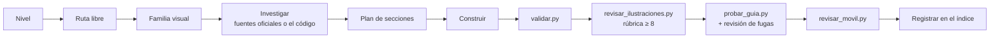

| Pieza | Para qué |
|---|---|
| [`SKILL.md`](.claude/skills/forja/SKILL.md) | El flujo de 11 pasos, con checklist |
| [`reference/diseno.md`](.claude/skills/forja/reference/diseno.md) | Dirección visual, familias, 10 layouts, anti-slop, celular, ritmo |
| [`reference/interacciones.md`](.claude/skills/forja/reference/interacciones.md) | Predicciones (y la prueba de la fuga), retos, ayudas, diagramas, simuladores, pasos, tarjetas |
| [`reference/ilustracion.md`](.claude/skills/forja/reference/ilustracion.md) | Dibujo técnico, animación de procesos, rúbrica de 10 puntos |
| [`reference/repos.md`](.claude/skills/forja/reference/repos.md) | Guías de un repositorio |
| `assets/esqueleto.html` | El núcleo compartido: progreso, mapa, predicciones, ayudas, retos, tarjetas, animación y el panel «Cómo usar» |
| `assets/fuentes/` | 13 familias tipográficas con licencia OFL, para incrustar |
| `scripts/validar.py` | Estructura, offline, anti-slop, citas, metadatos |
| `scripts/probar_guia.py` | Recorre la guía como una persona: interacciones, fugas, contraste, muros de texto |
| `scripts/revisar_ilustraciones.py` | Capturas grandes, 4 fases por animación, choques de etiquetas, texto ilegible |
| `scripts/revisar_movil.py` | Desbordes y errores de JS en celular, con capturas |
| `scripts/citas_repo.py` | Que cada permalink de una guía de repo exista en ese commit |
| `scripts/svg_kit.py` | Ayudante para generar dibujos con geometría calculada y comprobada |
| `scripts/actualizar_nucleo.py` | Lleva los cambios del núcleo a todas las guías sin tocar su contenido |
| `scripts/registrar.py`, `scripts/fuentes.py` | Ruta sin sobrescribir, índice y CSS de las fuentes |
| `.claude/hooks/proteger_guias.py` | Impide sobrescribir por accidente una guía con commit |

## Estructura

```text
.claude/skills/forja/   la skill (SKILL.md, reference/, assets/, scripts/, evals/)
familias/               estilos compartidos por temas relacionados
guias/                  una carpeta por guía, con un solo index.html
linea-base/             la guía hecha sin la skill, para comparar
docs/capturas/          las imágenes de este README
index.html              índice de guías con el repaso de hoy
.env.example            configuración local (cópialo a .env)
```

## Contribuir

Los cambios van en ramas y llegan a `main` con un pull request. Antes de dar por buena una guía, corre `validar.py`, `probar_guia.py` y `revisar_movil.py`. Las reglas del repo están en [CLAUDE.md](CLAUDE.md).
